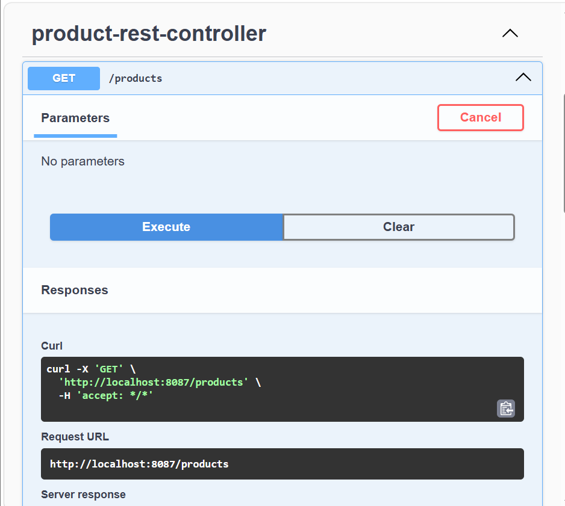
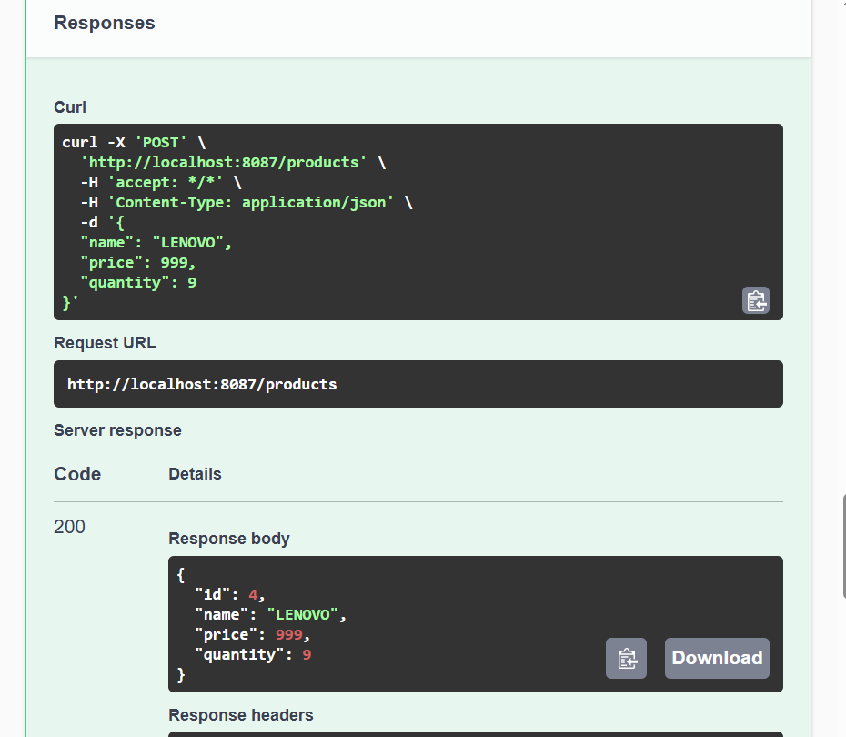
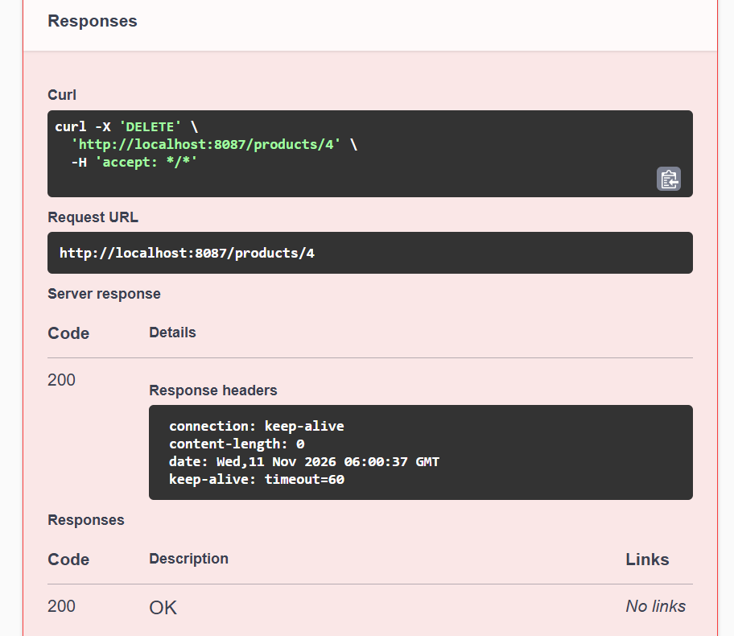

# TP : Création d'une API REST avec Spring Boot, Spring Data JPA & Swagger

Ce projet est une application backend réalisée dans le cadre d'un Travail Pratique basé sur le cours Spring JPA et Swagger et Rest Controller.

## 📋 Description du TP

L'objectif de ce TP est de concevoir et tester une API RESTful permettant de gérer un catalogue de produits (`Product`) en s'appuyant sur l'écosystème **Spring Boot** :

* **Spring Web (REST Controller)** : Exposition des endpoints HTTP (`GET`, `POST`, `DELETE`) au format JSON.
* **Spring Data JPA & Hibernate** : Persistance des données et création de requêtes personnalisées (recherche par mot-clé).
* **OpenAPI / Swagger UI** : Documentation interactive et test des différentes routes de l'API.

## 📸 Aperçu et Tests de l'API (Swagger UI)

### 1. Documentation OpenAPI (`product-rest-controller`)
Vue d'ensemble des endpoints disponibles sur le serveur (`http://localhost:8087/swagger-ui/index.html`) :

### 2. Récupération de tous les produits (`GET /products`)
Exécution d'une requête `GET` pour consulter la liste complète des produits enregistrés :

### 3. Ajout d'un nouveau produit (`POST /products`)
Création d'un nouvel article (`LENOVO`) via l'envoi d'un objet JSON dans le corps de la requête (Code réponse `200`) :

### 4. Recherche de produits par nom (`GET /find/products`)
Filtrage des produits contenant un caractère ou mot-clé spécifique (ici `?h=C` retournant `Computer`) :

### 5. Suppression d'un produit (`DELETE /products/{id}`)
Suppression d'un produit existant à partir de son identifiant (ici `/products/4`) :

## 🛠️ Technologies utilisées

* **Java / Spring Boot**
* **Spring Web (REST)**
* **Spring Data JPA / Hibernate**
* **Base de données H2 / MySQL**
* **Springdoc OpenAPI (Swagger UI)**